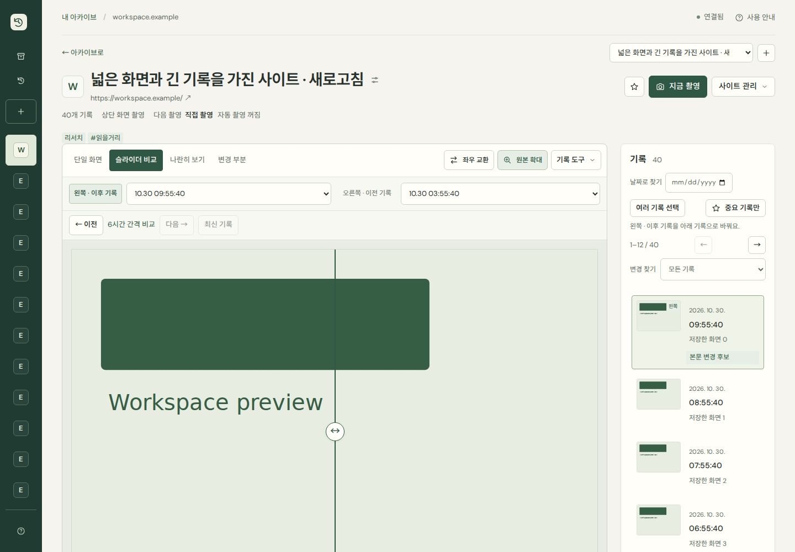
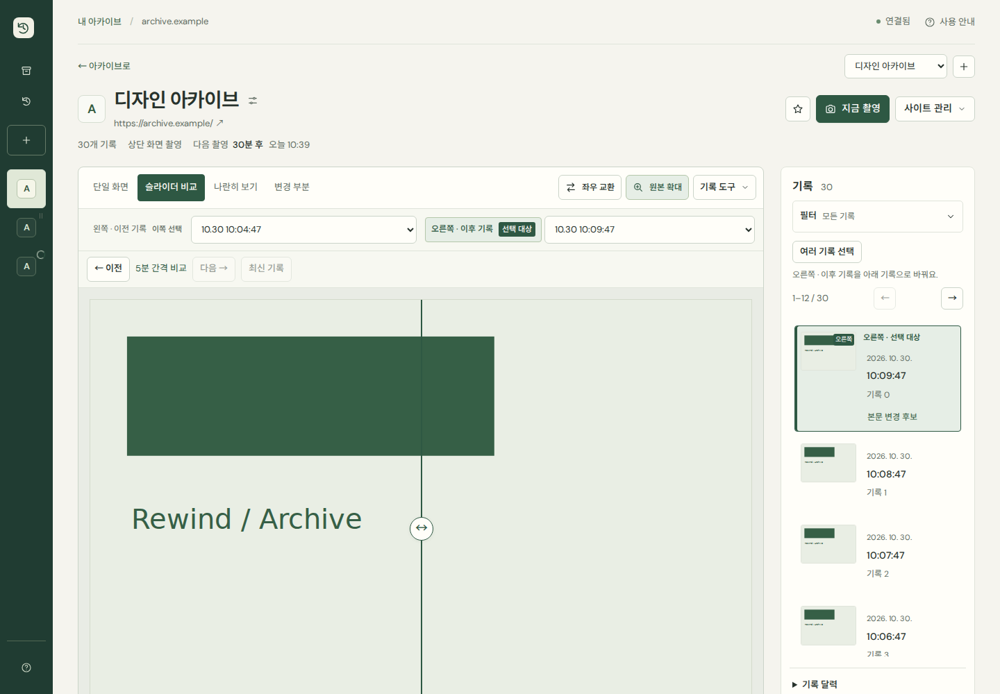
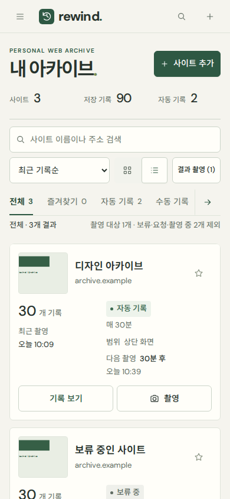

# 기록 탐색과 정보 위계 다듬기

기존 Archive & Workspace 디자인 위에서 세 부분을 다듬었습니다. 서버 API·촬영·자동 기록·데이터 모델은 변경하지 않았습니다.

- **기록 탐색:** 날짜·중요·본문 변경 필터를 하나의 접히는 패널로 묶었습니다. 적용 조건과 개수는 접어도 표시하며 기록 제목에는 필터 결과 수/전체 수를 보여줍니다. 조건 초기화와 결과 없음 초기화는 날짜·중요·본문 조건을 함께 정리합니다. 사용자가 펼친 상태는 기록 변경·비교 대상 전환·백그라운드 렌더링에서 유지합니다. 다중 선택과 페이지 이동은 필터 밖에 남겨 바로 사용합니다.
- **목록:** 기록 개수·최근 촬영을 ‘기록 정보’로, 기록 상태·주기·범위·다음 촬영을 ‘촬영 일정’으로 묶었습니다. 모바일에서는 두 묶음 아래에 기록 보기와 촬영을 배치합니다. 갤러리의 정보 구조는 유지합니다.
- **비교 선택:** 조작 중인 쪽에는 ‘선택 대상’, 반대편 기록에는 ‘비교 기록’ 라벨을 표시합니다. 타임라인에서도 활성 대상은 실선과 강조 배경, 비교 기록은 점선으로 구분합니다. 이전/이후는 실제 시간 관계를 유지하며 색만으로 구분하지 않습니다.

작은 화면에서도 비교 이미지까지의 거리가 늘어나지 않도록 380px 이하에서는 교환·슬라이더·나란히의 시각 라벨을 줄였습니다. 접근 가능한 이름은 전체 동작명으로 유지하며 터치 높이는 44px 이상입니다.

## 검증

- `npm test` 32개 통과.
- `npm run test:polish`: 1440·1024·768·390·360px에서 기록/일정 묶음의 겹침과 액션 잘림, 필터 접힘·조건 유지·복합 조건 결과 없음·초기화, 양쪽 선택 대상 라벨, 모바일 Tab 순환을 확인합니다. 모든 API는 브라우저 테스트 데이터로 처리합니다.
- 기존 기능·분류·본문 필터·비교·기록 관리·타임라인·반응형·대비 회귀 검사를 실행했습니다. 기존 자동 노출 동작에 맞춰 비교 대상 전환 후 타임라인 페이지 기대를 명시했습니다.
- 운영 화면을 1440·390px에서 읽기 전용 브라우저로 확인했습니다. 변경 요청은 차단했고 0건입니다. 기존 사이트와 기록 81개 전부를 보존했습니다. 자동 촬영으로 최종 확인 시 82개였으며 실제 주소에서 HTTP 200을 확인했습니다.
- 서브 에이전트는 사용하지 않았습니다.

아래는 운영 기록이 아닌 테스트 화면입니다. 이전/이후의 테스트 데이터 구성은 다를 수 있습니다. 동일 운영 사이트의 전후 화면은 Git에서 제외한 `test-results/usability-polish-before/`, `test-results/usability-polish-after/`에 보관합니다.

| 이전 | 이후 |
| --- | --- |
|  |  |

