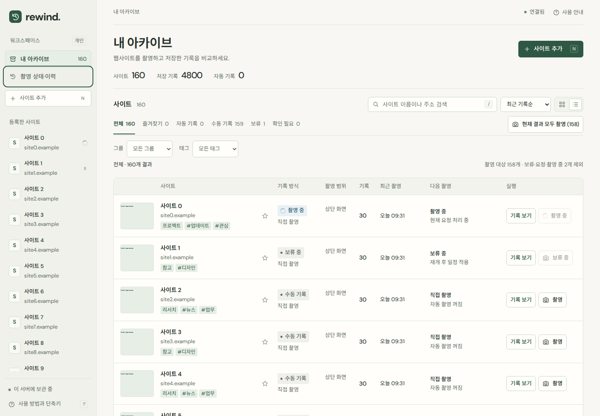
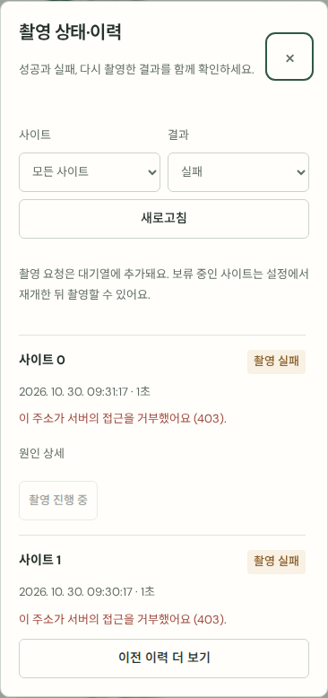

# 사이트 분류, 촬영 이력, 본문 변경 후보

기존 아이보리·포레스트 그린 UI와 사이트·기록을 유지하면서 후속 후보 세 가지를 구현했습니다.

## 사용 방법

- **태그·그룹:** 사이트 상세 → 사이트 설정 → 태그·그룹으로 분류. 사이트당 그룹 하나와 태그 최대 20개를 저장합니다. 목록에서 그룹·태그를 함께 필터링하고 분류 이름으로 검색할 수 있습니다. 필터는 URL에 보존되며 ‘현재 결과 모두 촬영’에도 적용됩니다. 비워 저장하면 해당 분류를 해제합니다.
- **촬영 상태·이력:** 사이드바 또는 사이트 관리 메뉴에서 엽니다. 전체 사이트·특정 사이트, 성공·실패·진행 중으로 조회합니다. 50개씩 추가 조회하며 실패 원인을 펼쳐 보고 다시 촬영할 수 있습니다. 재촬영은 기존 촬영 대기열을 사용하고 중복 요청을 막습니다. 보류 중에는 재개해야 합니다. 새로고침으로 최신 상태를 확인합니다. 저장에 성공한 이력에서는 해당 기록으로 이동합니다.
- **본문 변경 후보:** 상세 타임라인의 ‘변경 찾기’에서 본문 변경 후보·본문 동일·첫 분석 기록·분석 없음을 선택합니다. 선택 기록의 본문 분석 안내에서 기준 시각·설명·짧은 본문 발췌를 확인하고 기준 기록과 바로 비교합니다.

## 변경 분석의 범위

촬영 엔진이 화면에 렌더링된 main/article 본문을 우선 읽고, 없으면 body를 읽습니다. 공백·유니코드를 정규화한 텍스트의 SHA-256을 촬영 당시 직전 기록과 비교합니다. 전체 본문 대신 해시와 최대 240자 발췌를 보관합니다. 상단 화면 촬영에서도 스크린샷 범위 밖의 본문이 분석에 포함될 수 있습니다.

이것은 **본문 변경 후보를 찾는 기능**입니다. 광고·시각·자동 갱신 문구도 후보에 포함될 수 있고, 이미지·레이아웃만 달라지면 본문 동일로 나올 수 있습니다. 실제 의미의 변경을 단정하지 않습니다. 기존 픽셀 차이 강조 기능은 그대로 제공합니다.

기존 이미지 기록을 소급 분석하지 않으며 직접 가져온 이미지·본문 없음·본문이 제한을 초과해 잘린 경우는 분석 없음입니다. 주소나 분석 범위가 다르거나 직전 기록에 분석이 없는 경우도 변경을 추측하지 않습니다. 기존 사이트의 첫 새 촬영은 이후 비교를 위한 기준을 쌓습니다. 비교 기준이 삭제되면 해당 기준으로 이동하는 버튼만 사라지고 남은 기록과 분석 결과는 보존됩니다.

## 데이터와 접근

추가 컬럼과 촬영 이력 조회용 인덱스만 마이그레이션합니다. 기존 PNG·기록·일정은 삭제하거나 덮어쓰지 않습니다. 운영 사이트 등록·수동 촬영·기록 삭제는 검증에 사용하지 않습니다. 실제 촬영·삭제 회귀 검증은 `/tmp`의 별도 DB와 포트에서 수행합니다. 기존 IP 접근 제한을 유지합니다.

## 검증

- `npm test`: 32개 통과. 기존 스키마 마이그레이션·기록 보존, 분류 입력 검증, 106개 촬영 시도 조회·페이지 이동·조건 및 실제 로컬 브라우저의 main 본문 추출 포함.
- `npm run test:features`: 브라우저 안의 사이트 160개·촬영 시도 61개로 분류 저장/초기화/URL 복원/검색, 본문 필터/기준 비교, 이력 필터/추가 조회/재촬영 중복 방지/보류 제외/기록 이동, 에러 HTML 이스케이프 검증.
- 1440·768·390·360px에서 페이지/이력 모달 가로 넘침 없음, Tab 순환, Escape 닫기 및 모바일 메뉴로 포커스 복귀 확인.
- `npm run test:ui`, `npm run test:usability`: 기존 탐색·검색·비교·등록·일정·모달 회귀 검증.
- `npm run test:e2e`, `npm run test:records`: 별도 서버에서 실제 촬영과 기존 기록 관리 회귀 검증.

아래 이미지는 운영 데이터가 아닌 명시적인 브라우저 테스트 데이터입니다.

## 운영 반영 확인

운영 DB를 온라인 백업한 뒤 systemd 사용자 서비스를 재시작했습니다. 실제 접속 주소에서 HTTP 200과 새 촬영 이력 API를 확인했고, 1440·390px에서 목록·촬영 이력·기록 필터를 브라우저로 열었습니다. 검증 전후 사이트 1개·기록 79개를 확인했으며 기존 기록 ID 전부가 보존됐습니다. 운영 브라우저 검증은 변경 요청을 전부 차단했고 변경 요청 0건입니다. 서비스 자동 재시작과 기존 접근 제한을 유지합니다.
