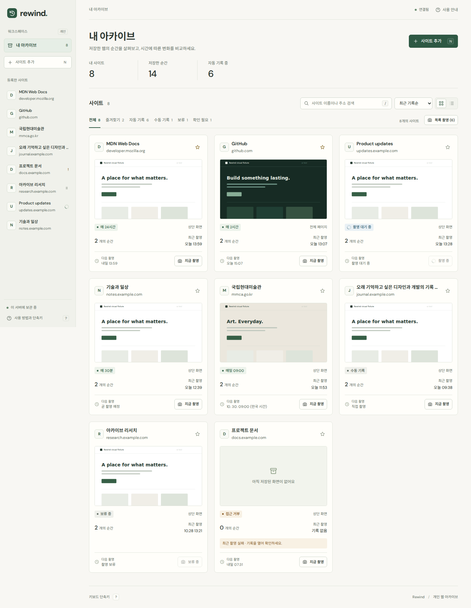
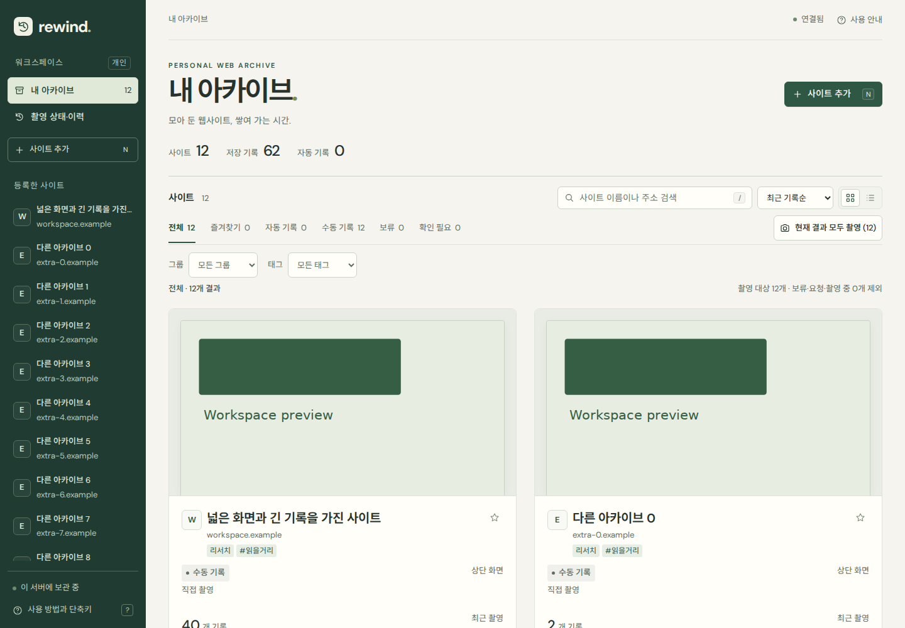
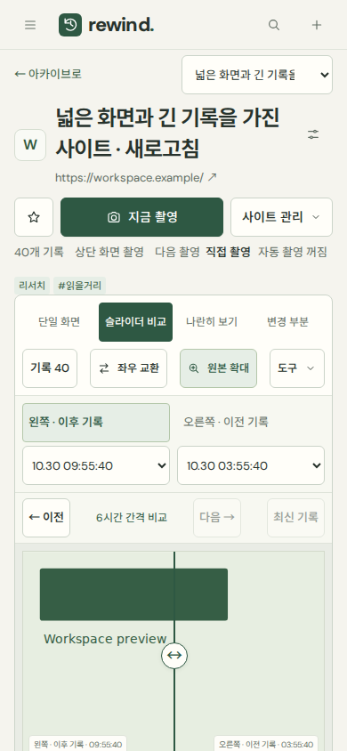

# Archive & Workspace 리디자인

Rewind의 아이보리·포레스트 그린을 유지하면서 홈과 기록 상세의 구조를 바꿨습니다. API·데이터 모델·촬영·일정·저장 기록은 그대로 사용합니다.

## 화면과 탐색

- **아카이브 홈:** 짙은 포레스트 그린 탐색 영역, 큰 제목과 정돈된 통계, 화면 미리보기가 먼저 나오는 갤러리. 사이트가 하나일 때는 이미지와 정보를 좌우로 배치하는 대표 카드가 됩니다. 목록은 큰 미리보기와 정렬된 메타데이터를 가진 행으로 바꿨습니다. 기존 보기 설정과 URL은 유지합니다.
- **데스크톱 상세(1100px 이상):** 왼쪽 탐색 영역을 아이콘 레일로 줄이고 중앙에 기록 화면, 오른쪽에 세로 타임라인을 배치합니다. 타임라인만 따로 스크롤하고 백그라운드 갱신 후 위치를 유지합니다. 달력과 촬영 설정은 오른쪽, 메모·중요 표시·본문 분석은 이미지 아래에 배치합니다.
- **태블릿(701~1099px):** 이미지 너비를 확보하고 기록 탐색을 아래에 가로로 배치합니다.
- **모바일(700px 이하):** 이미지 위의 ‘기록 N’을 누르면 하단 기록 탐색 패널이 열립니다. 썸네일이나 달력의 기록을 고르면 패널이 닫히고 해당 화면을 보여줍니다. 날짜를 누르는 경우에는 패널을 유지하여 같은 날의 기록을 더 살펴볼 수 있습니다. Escape·닫기 후 포커스가 트리거로 돌아갑니다.
- 모바일 검색·정렬·보기·결과 촬영을 묶었습니다. 분류가 없는 상태에서는 빈 태그·그룹 필터를 숨깁니다. 분류를 사용하면 기존대로 표시합니다.

원본 확대, 세 가지 비교 방식, 양쪽 비교 대상 선택·교환, 최신 기록, 날짜/본문/중요 필터, 다중 선택·삭제, 메모, 사이트 설정, 촬영 이력은 유지합니다. 왼쪽과 오른쪽 어느 기록을 바꾸든 선택한 썸네일을 스크롤 영역 안에 드러냅니다.

## 구현과 접근성

기존 `style.css`의 공통 컴포넌트를 재사용하고 새 레이아웃을 `public/workspace.css`로 분리했습니다. 기록 타임라인 DOM은 하나만 두며 모바일 패널로 이동합니다. 두 화면용 DOM을 복제하거나 ID를 중복하지 않습니다.

닫힌 details 안의 컨트롤을 모달 Tab 순환에서 제외하고, 다중 선택 시 스크롤 스냅이 체크박스를 가리지 않게 처리했습니다. 목록의 액션 버튼은 촬영 상태에 따라 열이 흔들리거나 카드 밖으로 잘리지 않게 검증했습니다. 대비·키보드 포커스·44px 터치 영역·축소 애니메이션 설정도 유지합니다.

## 검증

- `npm test` 32개 통과.
- `npm run test:workspace`: 1440·1024·768·390·360px, 목록 버튼 잘림·가로 넘침·중복 ID 없음, 세로 기록 스크롤·위치 복원, 좌우 선택한 기록 노출, 모바일 패널 Tab·Escape·선택 후 포커스 복귀, 메모·달력·다중 삭제 검증. 모든 API는 브라우저 안의 테스트 데이터로 처리합니다.
- `npm run test:ui`, `npm run test:usability`, `npm run test:features`, `npm run test:design` 통과.
- 별도 `/tmp` DB·포트에서 `npm run test:e2e`, `npm run test:records`, `npm run test:page-calendar` 통과. 실제 촬영·PNG·슬라이더·나란히·변경 표시·일정·기록 관리 회귀 확인.
- 실제 운영 주소에서 HTTP 200과 1440·390px 렌더링 확인. 변경 요청을 차단한 브라우저로 검증했으며 운영 사이트 추가·촬영·삭제 요청은 0건입니다. 검토 전 기록 79개를 전부 보존했고 자동 기록으로 80개가 됐습니다. 기존 접근 제한과 systemd 서비스를 유지했습니다.

## 화면

아래 저장소 이미지는 운영 데이터가 아닌 브라우저 테스트 데이터입니다. 이전 화면과 데이터 구성·시각은 다를 수 있습니다. 실제 운영 화면의 동일 사이트 전후 캡처는 Git에서 제외한 `test-results/usability-workspace-before/`와 `test-results/usability-workspace-after/`에 보관합니다.

| 이전 홈 | 변경한 홈 |
| --- | --- |
|  |  |

